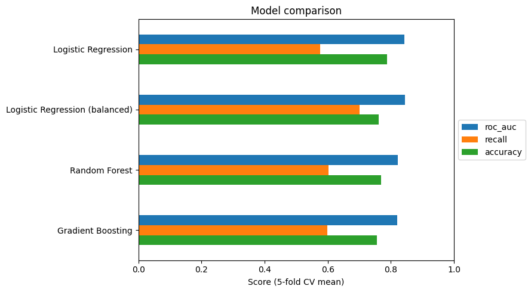
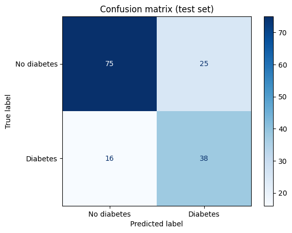
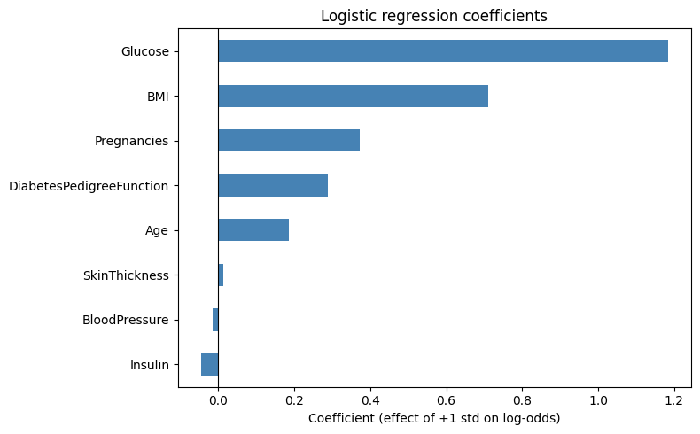

# Diabetes Risk Prediction

Predicting the onset of diabetes from routine clinical measurements, with a focus on
**correct preprocessing, leakage-free evaluation, and model interpretability**.

- **Dataset:** Pima Indians Diabetes Database (768 patients, 8 clinical features)
- **Final model:** Logistic Regression (class-balanced) in a scikit-learn pipeline
- **Test set performance:** ROC-AUC **0.81** · Recall **0.70** · Accuracy **0.73**

## Key results

| Model | ROC-AUC (5-fold CV) | Recall (CV) |
|---|---|---|
| Baseline (always "no diabetes") | 0.500 | 0.000 |
| Logistic Regression | 0.843 | 0.575 |
| **Logistic Regression (balanced)** | **0.844** | **0.701** |
| Random Forest | 0.821 | 0.603 |
| Gradient Boosting | 0.820 | 0.598 |



More complex models did **not** outperform logistic regression on this small dataset.
We selected balanced logistic regression for its highest recall and ROC-AUC, plus its simplicity and interpretability.

### Final evaluation on the held-out test set (n = 154)



The model detects **38 of 54** diabetic patients and produces 25 false alarms among 100 non-diabetic patients.
Test results are consistent with cross-validation.

### What drives the prediction?




**Glucose** (odds ratio ≈ 3.3 per standard deviation) and **BMI** (≈ 2.0) are the strongest predictors,
in line with clinical knowledge. Insulin has almost no weight despite its correlation with the outcome,
because it overlaps with Glucose and ~47% of its values are missing.

## Approach

1. **Hidden missing values.** The dataset reports no nulls, but zeros in Glucose, BloodPressure,
   SkinThickness, Insulin, and BMI are physiologically impossible. They were converted to missing values
   (Insulin: 48.7% missing, SkinThickness: 29.6%).
2. **No data leakage.** Imputation (median) and scaling are inside a scikit-learn `Pipeline`,
   fitted on training data only, including within each cross-validation fold.
3. **Honest evaluation.** Stratified 80/20 train/test split. Model selection used only
   stratified 5-fold cross-validation on the training set; the test set was used **once**.
4. **Meaningful metrics.** Classes are imbalanced (65/35), so a naive model reaches 65% accuracy
   while detecting no patients. Models were compared with ROC-AUC and recall, and
   `class_weight="balanced"` was used to reduce missed diagnoses.

## Project structure

```text
diabetes-risk-prediction/
├── data/
│   ├── diabetes.csv              # dataset
│   └── README.md                 # data source and description
├── notebooks/
│   ├── 01_eda.ipynb              # exploratory data analysis
│   ├── 02_modeling.ipynb         # pipeline, baseline, model comparison
│   └── 03_evaluation.ipynb       # test set evaluation and interpretation
├── reports/figures/              # figures used in this README
├── LICENSE
└── README.md
```

## How to run

Each notebook has an **Open in Colab** badge at the top. The data is loaded directly from this
repository, so no installation is needed. Run the notebooks in order (01 → 02 → 03).

Main libraries: pandas, NumPy, scikit-learn, matplotlib, seaborn.

## Limitations

- Small dataset (768 patients): test metrics have high variance.
- The population is limited to women of Pima Indian heritage aged 21+; results may not generalize.
- Median imputation for Insulin and SkinThickness, which have many missing values, is a simplification.
- This is an educational project and not a clinical tool.

## Data source

Originally from the National Institute of Diabetes and Digestive and Kidney Diseases (NIDDK),
available on [Kaggle](https://www.kaggle.com/datasets/uciml/pima-indians-diabetes-database).

## Author

**Koroush Mashayekh**, MSc student, University of Padova

## License

MIT
